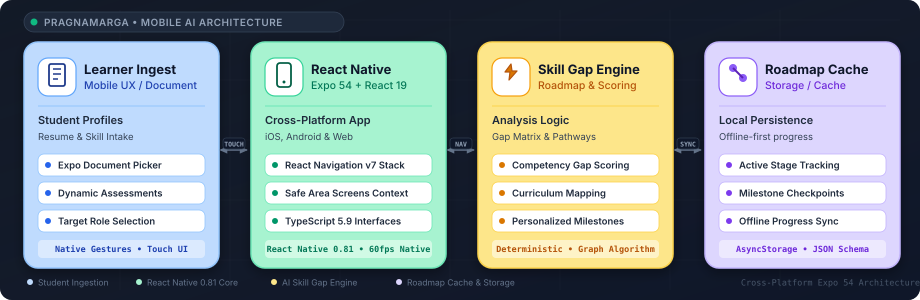

<div align="center">


<br/>

<a href="#system-architecture">
  
</a>
&nbsp;
<a href="#system-architecture">
  
</a>
&nbsp;
<a href="#system-architecture">
  
</a>
&nbsp;
<a href="#system-architecture">
  
</a>
&nbsp;
<a href="#system-architecture">
  
</a>

</div>

<br/>

# PragnaMarga — AI Career Navigator & Skill Gap Platform

A cross-platform mobile application built with React Native 0.81, Expo 54, and TypeScript 5.9 that guides engineering students through resume ingestion, technical skill gap analysis, and personalized roadmap milestones.

PragnaMarga empowers aspiring software engineers by analyzing their existing skill profiles, uncovering missing prerequisites for target industry roles, and generating structured step-by-step milestones with native 60 FPS performance.

---

## System Architecture

<p align="center" style="margin: 20px 0;">
  
</p>

* **Learner Ingest (Mobile UX / Document)**: Student profile, resume, and skill intake via Expo Document Picker and dynamic target role assessments.
* **React Native (Expo 54 + React 19)**: Cross-platform iOS, Android, and web app with React Navigation v7 stack and TypeScript 5.9 typed interfaces.
* **Skill Gap Engine (Roadmap & Scoring)**: Deterministic gap matrix scoring, curriculum mapping, and personalized milestone graph generation.
* **Roadmap Cache (Storage / Cache)**: Offline-first persistence via AsyncStorage, active stage tracking, and checkpoint synchronization.

---

## Key Features

- **Native Document Picking**: Integrated with `expo-document-picker` to parse PDF and text resumes on iOS and Android.
- **Dynamic Competency Assessments**: Timed interactive quizzes evaluating foundational algorithms, databases, and track-specific skills.
- **Three-Tier Gap Scoring**: Categorizes technical competencies into Mastered ($\ge 80\%$), In Progress (50–79%), and Critical Gap ($< 50\%$).
- **Personalized Roadmap Timeline**: Graph-based milestone generator ordering topics by fundamental prerequisite hierarchies.
- **Offline-First Progress**: Local caching of completed stages, quiz scores, and student profiles for on-the-go study.

---

## Engineering Documentation

The project includes a complete production-grade architecture and development documentation suite:

| Document | Purpose |
| :-- | :-- |
| [**`docs/PRD.md`**](./docs/PRD.md) | Product Requirements Document: MVP specifications, target personas & success metrics |
| [**`docs/ARCHITECTURE.md`**](./docs/ARCHITECTURE.md) | System topology, roadmap scoring pipeline, directory tree & ADRs |
| [**`docs/RULES.md`**](./docs/RULES.md) | Engineering standards, TypeScript conventions, and mobile performance guardrails |
| [**`docs/DESIGN.md`**](./docs/DESIGN.md) | Design system, UI tokens, Inter & JetBrains Mono typography, and milestone cards |
| [**`docs/TASKS.md`**](./docs/TASKS.md) | Phased roadmap tracking 24 engineering deliverables with priority & status badges |
| [**`docs/MEMORY.md`**](./docs/MEMORY.md) | Active session memory, completed milestone log, and operational boundaries |

---

## Setup Instructions

### Prerequisites
- Node.js (`v18+` or `v20+`)
- npm / yarn / bun
- Expo Go app on iOS/Android (or Android Studio / Xcode simulators)

### 1. Clone the repository
```bash
git clone https://github.com/abhishek4643/PragnaMarga.git
cd PragnaMarga
```

### 2. Install dependencies
```bash
npm install
```

### 3. Launch Expo Development Server
```bash
npm run start
```
- Press `a` to open on an Android emulator or connected device.
- Press `i` to open on an iOS simulator.
- Press `w` to open on a web browser.
- Scan the displayed QR code with the **Expo Go** mobile app to run directly on physical hardware.

---

## License

This project is open-source and available under the MIT License.

