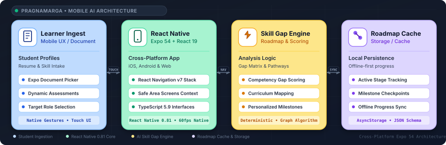

# System Architecture
### PragnaMarga — Architectural Topology, Data Flow, and System Specifications

<div align="center">
  
</div>

This document describes the overall mobile system architecture, technology stack, directory structure, skill gap algorithms, and key design decisions for the **PragnaMarga** career navigator.

---

### 1. High-Level Architecture

PragnaMarga is built on an event-driven cross-platform mobile architecture connecting native document picking and assessment screens with a client-side skill scoring engine and roadmap persistence cache:

<p align="center" style="margin: 20px 0;">
  
</p>

---

### 2. Technology Stack

Technologies used across PragnaMarga and their architectural purpose:

| Domain | Technology | Implementation Detail |
| :-- | :-- | :-- |
| **Mobile Runtime** | Expo 54 (v54.0.0) | Managed cross-platform mobile toolchain with pre-configured native build tooling |
| **Mobile Framework** | React Native (v0.81.5) | High-performance mobile UI framework compiling to native iOS and Android primitives |
| **UI Library** | React 19 (v19.1.0) | Latest React release delivering enhanced concurrent rendering and hooks |
| **Type System** | TypeScript (v5.9.2) | End-to-end type safety across assessment models, route params, and theme tokens |
| **Navigation Core** | React Navigation v7 | `@react-navigation/native` & `@react-navigation/native-stack` for native screen stacks |
| **Native Document Access**| Expo Document Picker | Cross-platform file selector for PDF and DOCX resume uploads |
| **Safe Area Engine** | React Native Safe Area Context | Hardware notch, island, and home-indicator offset normalization |
| **Screen Optimization**| React Native Screens | Native platform view primitives optimizing navigation memory and transitions |
| **Styling & Theming** | Custom Design System | Modular theme tokens (`src/theme/`) supporting light and dark UI variants |

---

### 3. Directory Structure

```text
CareerPathApp/
├── assets/                         # Application Icons, Splash Screens & Graphics
├── src/                            # React Native TypeScript Source
│   ├── components/                 # Reusable Native UI Components
│   │   ├── Button.tsx              # Styled TouchableOpacity Native Buttons
│   │   ├── Card.tsx                # Elevated Surface Containers
│   │   └── ProgressBar.tsx         # Animated Assessment Progress Indicator
│   ├── screens/                    # Native Application Screen Views
│   │   ├── HomeScreen.tsx          # Welcome Dashboard & Role Selection
│   │   ├── AssessmentScreen.tsx    # Multi-Stage Dynamic Skill Evaluation
│   │   ├── ResultScreen.tsx        # Skill Gap Breakdown & Competency Scores
│   │   ├── RoadmapScreen.tsx       # Interactive Milestone Learning Timeline
│   │   ├── ProfileScreen.tsx       # Student Academic & Target Role Overview
│   │   ├── AccountDetailsScreen.tsx# Account Settings & Credential Management
│   │   ├── HelpSupportScreen.tsx   # FAQ & Guidance Resources
│   │   └── PrivacyScreen.tsx       # Privacy Policy & Document Handling Info
│   ├── theme/                      # Design Tokens, Palette Colors & Typography
│   └── utils/                      # Skill Scoring Math & Storage Utilities
├── docs/                           # Complete Architecture & Engineering Docs
│   ├── ARCHITECTURE.md             # System Topology & Algorithm Specifications
│   ├── DESIGN.md                   # Design System & UI Specifications
│   ├── MEMORY.md                   # Operational State & Milestone Log
│   ├── PRD.md                      # Product Requirements & User Scenarios
│   ├── RULES.md                    # Engineering Conventions & Coding Rules
│   ├── TASKS.md                    # Phased Roadmap with 24 Deliverables
│   ├── architecture.svg            # Custom 4-Card Vector Topology
│   ├── palette.svg                 # 8-Swatch Design System Vector Palette
│   └── principles.svg              # 4-Card Design Principles Vector
├── App.tsx                         # Root Application Navigator & Theme Wrapper
├── app.json                        # Expo 54 Configuration & App Metadata
├── package.json                    # Dependencies & NPM Scripts
├── tsconfig.json                   # Strict TypeScript Compiler Flags
└── README.md                       # Repository Entry & Developer Guide
```

---

### 4. Skill Gap & Roadmap Processing Flow

```text
Student Resume & Target Track (e.g., "Full-Stack AI Engineer")
       │
       ▼
[ Assessment Screen ] ──────► Timed technical evaluation (15 Questions)
       │
       ▼
[ Competency Scoring Engine ]
       │
       ├──── Core CS (DSA, OS, Networks) ────► 85% &bull; MASTERED
       ├──── Frameworks (React, FastAPI) ────► 75% &bull; IN PROGRESS
       └──── GenAI / Vector Stores ──────────► 40% &bull; CRITICAL GAP
       │
       ▼
[ Graph Milestone Generator ]
       │
       ▼
Personalized Learning Roadmap (Ordered by prerequisite hierarchy)
       Stage 1: Python Advanced & Async IO
       Stage 2: Vector Embeddings & Supabase pgvector
       Stage 3: LLM Orchestration & Sandboxed Runtimes
```

---

### 5. Architectural Decision Records (ADRs)

#### ADR-001: React Native 0.81 + Expo 54 Managed Workflow
- **Context**: Developing separate native Android (Kotlin) and iOS (Swift) applications doubles maintenance effort and delays roadmap iterations.
- **Decision**: Adopt the Expo 54 managed workflow with React Native 0.81.
- **Consequence**: Single codebase deploys effortlessly across iOS, Android, and Web with native 60 FPS performance.

#### ADR-002: React Navigation v7 Native Stack
- **Context**: JavaScript-based tab navigators incur visual stutter during complex screen transitions on lower-end Android devices.
- **Decision**: Use `@react-navigation/native-stack`, which leverages native Android `Fragment` and iOS `UINavigationController` primitives under the hood via `react-native-screens`.
- **Consequence**: Ensures buttery-smooth native screen push/pop transitions with zero JS thread blocking.

#### ADR-003: Deterministic Graph-Based Skill Gap Scoring
- **Context**: Random generative outputs for career roadmaps yield inconsistent advice across multiple runs.
- **Decision**: Implement a deterministic competency scoring matrix that maps skill deficits against verified prerequisite trees.
- **Consequence**: Produces reproducible, trustworthy milestone sequences for engineering students.
