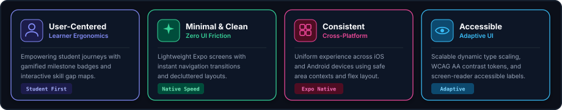
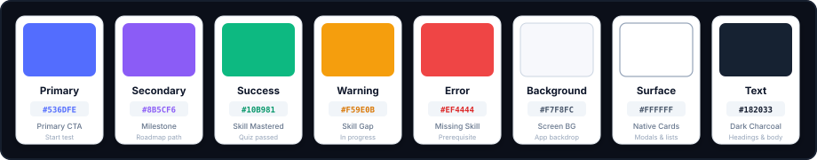

# Design System
### PragnaMarga — Clean. Simple. Productive.

  

This document defines the mobile visual design system, UI components, design tokens, and user experience standards for the **PragnaMarga** AI career navigator. The goal is to establish an engaging, modern, minimal mobile interface with consistent styling across assessment flows, competency summaries, and interactive roadmap timelines.

---

### 1. Design Principles

  

---

### 2. Color Palette
*Primary colors used across the mobile application screens, assessment states, and roadmap timelines:*

  

---

### 3. Typography
*We use Inter as the primary interface font and JetBrains Mono for scores, milestone IDs, and code snippets:*

  <table width="100%" cellpadding="0" cellspacing="0" border="0">
    <tr>
      <td width="90" align="center" style="font-size: 40px; font-weight: 800; background-color: #161B22; color: #818CF8; border: 1px solid #30363D; border-radius: 8px; padding: 8px 12px;">Aa</td>
      <td style="padding-left: 20px;">
        
Inter &amp; JetBrains Mono

        
Primary mobile font family

        
Clean, modern, and highly legible across mobile screens, quiz questions, and roadmap milestones.

      </td>
    </tr>
  </table>

| Role | Font Family | Size / Weight | Usage |
| :-- | :-- | :-- | :-- |
| **Screen Title** | Inter | 22px / 700 Bold | Top mobile navigation headers |
| **Card Header** | Inter | 16px / 600 Semi-Bold | Milestone and quiz option titles |
| **Body Regular** | Inter | 14px / 400 Regular | Explanatory text and descriptions |
| **Score / Badge** | JetBrains Mono | 12px / 600 Semi-Bold | Percentage scores, stage indexes, timestamps |

---

### 4. UI Components & Visual Tokens

#### 4.1 Skill Competency Badges

| Level | Background | Text Color | Border | Meaning |
| :-- | :-- | :-- | :-- | :-- |
| **MASTERED** | `#ECFDF5` | `#059669` | `1px solid #A7F3D0` | Score $\ge 80\%$ &bull; Verified competence |
| **IN PROGRESS** | `#FFFBEB` | `#D97706` | `1px solid #FDE68A` | Score $50\% - 79\%$ &bull; Moderate gap |
| **CRITICAL GAP** | `#FEF2F2` | `#DC2626` | `1px solid #FECACA` | Score $< 50\%$ &bull; Prerequisite priority |

#### 4.2 Active Milestone Roadmap Card

  

    

      Stage 02 &bull; Active Milestone
      
FastAPI &amp; Asynchronous Microservices

    

    

      IN PROGRESS (65%)
      
Next: <code style="color: #34D399;">SQLAlchemy 2.0 ORM</code>

    

  

